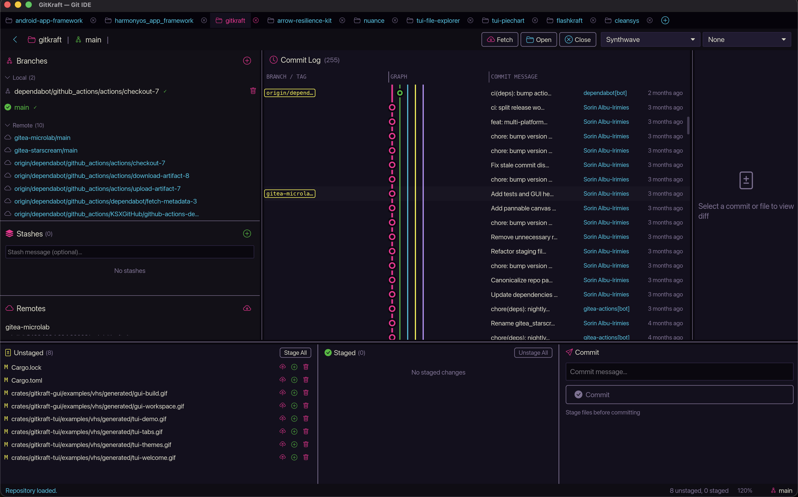
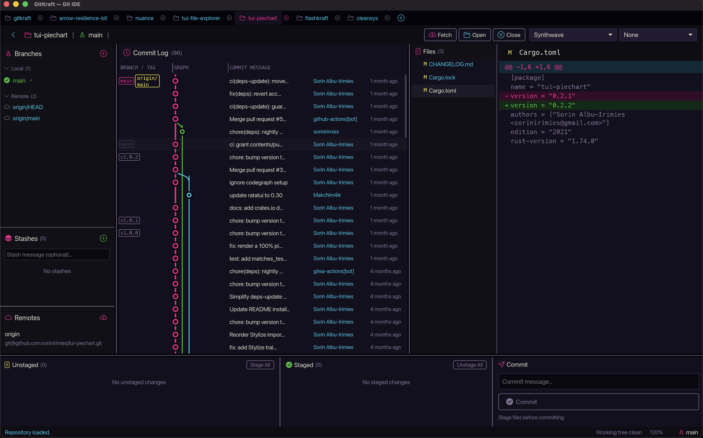
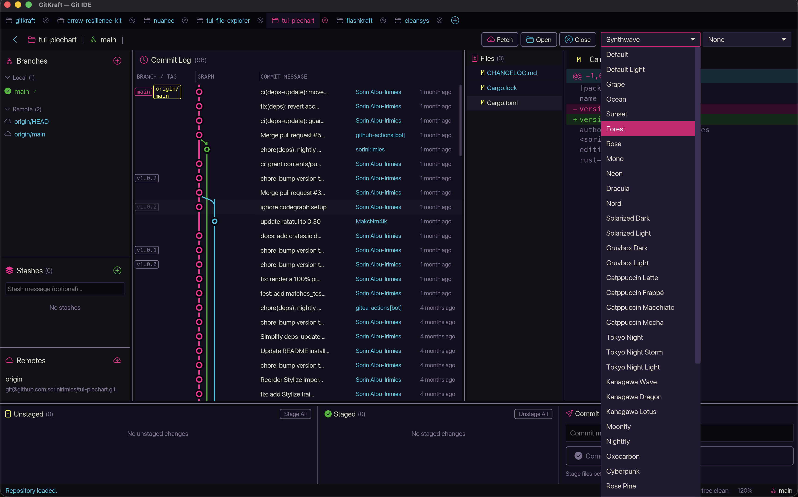

<div align="center">

# ⚡ GitKraft

**A Git IDE written entirely in Rust — desktop GUI & terminal UI**

[](https://crates.io/crates/gitkraft)
[](https://crates.io/crates/gitkraft)
[](https://crates.io/crates/gitkraft-tui)
[](https://docs.rs/gitkraft-core)
[](LICENSE)
[](https://github.com/sorinirimies/gitkraft/actions/workflows/security.yml)
[](https://github.com/sorinirimies/gitkraft/actions/workflows/fuzz.yml)

</div>

---

GitKraft ships two front-ends from a single Rust workspace:

| Binary | Use case |
|--------|----------|
| `gitkraft` | Desktop GUI — mouse, drag-to-resize panes, commit graph |
| `gitkraft-tui` | Terminal UI — keyboard-driven, great for SSH & headless machines |


## Preview

### Desktop GUI






### Terminal UI


## The hub: no more forge dashboards

Press `H` in the TUI (or the **Hub** button in the GUI) for pull requests, issues, CI and
notifications of **GitHub, GitLab, Gitea / Forgejo and Codeberg** in one place. `gitkraft-web`
serves the same on localhost.

| | |
|---|---|
| Dashboard | sections are saved queries (`dashboard.toml`): "Review requested", "My PRs", issues, CI of a repo, the inbox |
| Several remotes | a checkout with GitHub, Codeberg, a Gitea and a GitLab remote is one project: the hub header shows `⎇ all remotes  origin ✔  codeberg ↑1  gitea ⇄` (✔ in sync, ↑ the remote lacks commits, ↓ it has more, ⇄ diverged, ∅ no such branch, from the last fetch). `o` in the TUI, the button in the GUI and the chips on the web page switch between all forges and one; rows say which forge they come from (`repo@codeberg`), and a CI run shows how the same commit fared on the other forges (`≡ codeberg ✘`). CLI: `gitkraft-tui remotes`, `-R codeberg` (a remote name works where a repository does), `runs --all-remotes`, `prs --all-remotes`, `push-all` (the current branch to every forge remote, one result each, never forced); MCP: `remotes`, `ci_runs_all_remotes`, `push_all_remotes` (with `--write`), and a remote name as `repo`. Writes always name one remote |
| Pull requests | description (Markdown), reviews, checks, diff, comments; approve, request changes, comment, merge, close |
| Issues | list, comment, close / reopen |
| CI | runs, jobs, steps, timeline, live log with errors extracted; re-run failed / all, cancel (GitHub / Gitea Actions, GitLab CI) |
| Discussions, wiki & boards | GitHub discussions (list, read, comment); the wiki of GitLab, Gitea, Forgejo and Codeberg repos (list, read); boards (GitHub Projects v2, GitLab issue boards: cards by column, opened as their issue, moved to another column; Gitea has no board API). Discussion comments can be answered inside their thread and wiki pages created and edited (the TUI and GUI hand the page to your editor and send it back; the web page has a text box; the CLI reads a file, stdin or `--edit`). GitHub wikis have no API: they are git repos (`<repo>.wiki.git`), so gitkraft clones them into its cache (https, then ssh, never a password prompt), reads pages from there and saves by commit and push. A wiki needs its first page created on the web before it can be cloned. TUI key `T`, GUI tab, web `/community`, MCP tools `discussions`, `wiki` and `boards` |
| Pulse | contribution calendar over all accounts (click a day, or use the arrow keys, for what you did that day: commits per repository, PRs, issues, reviews, comments), PRs / issues / CI per period, activity per day |
| Notifications | per-project settings, desktop notifications, a bell with its state on every project |
| Mouse | click, wheel, drag a section tab to reorder, drag the divider to resize (TUI and GUI) |
| Images | PR and issue pictures in the TUI (Kitty, iTerm2, Sixel or half blocks) |

**Accounts.** Tokens are read, never stored: `GITKRAFT_TOKEN_<HOST>`, `GITHUB_TOKEN`, `GITLAB_TOKEN`,
`CODEBERG_TOKEN` / `GITEA_TOKEN`, or `gh auth login`. Self-hosted instances go in
`~/.config/gitkraft/accounts.toml`:

```toml
[[account]]
kind = "gitlab"      # github | gitlab | gitea (also forgejo, codeberg)
host = "git.example.com"

[[account]]
kind = "gitea"
host = "codeberg.org"
woodpecker = "https://ci.codeberg.org"   # CI runs, steps, logs, restart, cancel come from Woodpecker
```

A Woodpecker token (from the server's user page) is read from `GITKRAFT_WOODPECKER_TOKEN_<HOST>` or
`GITKRAFT_WOODPECKER_TOKEN`; Woodpecker restarts whole pipelines only and has no artifacts.

**Sign in once.** `gitkraft-tui login github.com` runs the OAuth device flow (GitHub, GitLab; needs an OAuth
application's client id: `--client-id`, `GITKRAFT_OAUTH_CLIENT_ID` or `oauth_client_id` in `accounts.toml`);
`login HOST --token` takes a pasted token and works everywhere. The token is checked, then stored in the
system keyring (macOS `security`, Linux `secret-tool`); `logout HOST` removes it. Lookup order: environment,
keyring, `gh` / `glab`, git's credential helper.

**Merging.** Besides review (approve, request changes, inline comments) and `m`/`M` merge or squash, a PR can
be updated, auto-merged, queued or force-merged from the TUI, the GUI and the web page:

| TUI | What | GitHub | GitLab | Gitea / Codeberg |
|---|---|---|---|---|
| `u` | update branch | `update-branch` (merge) | `rebase` | `update?style=merge\|rebase` |
| `W` | merge when checks pass | GraphQL auto-merge | `merge_when_pipeline_succeeds` | `merge_when_checks_succeed` |
| `Q` | add to merge queue | GraphQL `enqueuePullRequest` | merge train (same call as `W`) | same as `W` (no queue) |
| `!` | force merge (capital `Y` to confirm; GUI and web ask twice) | admin bypass if the branch rule allows it; with `Q` it jumps the queue | not available | `force_merge` |
| `Z` | cancel auto-merge / leave queue | disable auto-merge, else dequeue | cancel merge-when-pipeline-succeeds | delete scheduled merge |
| `S` | cycle the method used by `W`, `Q`, `!` | | | |

GitLab cannot merge by rebase through the merge call or force past its checks, and GitHub can only update a
branch by merging; those combinations say so instead of guessing.

**Labels.** `L` in the TUI (or the GUI's Labels button, text from the note box) edits labels of a PR or issue:
`+bug -wontfix \"good first issue\"`; GitHub, Gitea / Codeberg and GitLab.

**Clone.** `gitkraft-tui clone owner/name` (or `host/owner/name`, or a URL) clones with your system `git`, over
`--ssh` / `--https`, else the account's `clone_via` in `accounts.toml`, else https.

**Git over SSH.** fetch, pull and push use your system `git` and `ssh` (agent, `~/.ssh/config`, keychain), and
a failure says what to do. `gitkraft-tui ssh …` gets a key in place:

```sh
gitkraft-tui ssh setup github.com      # create ~/.ssh/gitkraft_github.com (or --key PATH), register it, configure, load, test
gitkraft-tui ssh list github.com       # keys on the account; ● = held by this machine
gitkraft-tui ssh revoke github.com ID  # remove one
gitkraft-tui ssh status                # key, config block, agent, connection per host
gitkraft-tui ssh switch ssh            # rewrite origin from https to ssh (or back)
```

Setup is idempotent, edits only a marked block of `~/.ssh/config` (and saves a backup first), and never sees a
passphrase (`--passphrase` lets `ssh-keygen` ask). The Hub's **SSH keys** view (`K`) does the same from the UI. `ssh status` honours your own `~/.ssh/config`: a `Host` entry with an `IdentityFile` (even outside `~/.ssh`) is the key reported, ahead of gitkraft's. The settings menu opens from the hub with `,` or the palette.
`clone_via = "ssh" | "https"` per `[[account]]` records which transport you prefer.

**Workflow inputs.** `D` (and the GUI's Dispatch) reads `workflow_dispatch.inputs` from the workflow file: defaults
fill what you leave out, `choice`/`boolean`/`number` values are checked, and a missing required input is named.
**Inline comments** work on removed lines too (old side), and in the GUI by clicking a diff line.

**Palette and more.** In the TUI `:` or Ctrl+P, in the GUI Ctrl/Cmd+P or the **Commands** button, opens a fuzzy
command palette with every action that applies to the selection. **Open in the browser:** a pull request, issue, CI run or notification opens on its forge with `b` in the TUI hub (also in the `?` menu and the right-click menu), the "Open in browser" button in the GUI (and the palette), and an "Open in browser ↗" link on the web pages. Only http(s) links are ever opened.

**Self-hosted forge on http or another port:** a remote like `gitea@192.168.1.44:sorin/gitkraft.git` names only the SSH host, so say where the web server is in `accounts.toml`: `[[account]]` with `kind = "gitea"`, `host = "192.168.1.44"` and `url = "http://192.168.1.44:3000"`. Everything (pull requests, issues, CI) then talks to that URL; other hosts keep `https://<host>`.

**Tray and start at login (macOS, Linux, Windows):** the GUI puts an icon in the menu bar / system tray with a menu (open GitKraft, open the hub, run the agent jobs now, "Start at login", "Keep running in the tray when the window closes", quit). `gitkraft-tui autostart on|off|status` (or the menu) adds or removes the login entry: a LaunchAgent on macOS, an XDG autostart file on Linux, the `Run` registry key on Windows. Logging in starts GitKraft hidden in the tray with the hub running behind it. The settings (`autostart`, `tray_icon`, `close_to_tray`) live in `settings.json`. On Linux the tray speaks StatusNotifierItem: it shows on KDE, COSMIC (add the "Status Area" applet to the panel), XFCE, Cinnamon, MATE, LXQt, Ubuntu's GNOME and any bar with a tray (waybar). Stock GNOME (Fedora, Debian, Arch, EndeavourOS, Manjaro) needs the `gnome-shell-extension-appindicator` package and `gnome-extensions enable appindicatorsupport@rgcjonas.gmail.com`; without a tray the window opens normally and the log says what to install for your distribution. The login entry works in AppImage (it records `$APPIMAGE`) and Flatpak (it asks the Background portal; the Flatpak needs `--talk-name=org.kde.StatusNotifierWatcher` for the tray).

**The agent schedule belongs to one running GitKraft:** the daily jobs run only while a GitKraft instance is open (window, tray, TUI or web), and exactly one instance holds the schedule at a time (a lease file in the reports folder, renewed every 30 s and taken over 90 s after its holder goes away), so two open copies never start the same job twice. The tray menu says which instance runs it.

**Mouse:** the main screen and the hub capture the mouse (hold Shift to select text in most terminals). Click a pane or row to focus and select it, double-click to open (check out a branch, show a commit or file diff), scroll the wheel over a list, drag the hub dividers and tabs. **Right-click** a branch, commit, file, stash or hub row (pull request, issue, CI run, job, key, agent job) for a menu of what you can do to it; a click runs the entry, a click outside or Esc closes it, arrows and Enter work too. The header is clickable too (repository tabs and the `[key] label` hints), as are the theme list, the settings menu (`M`) and the editor picker; a click outside or a right-click closes a panel. Every entry presses the key the pane already has, so menu and keys cannot drift apart. **Editor:** `E` on the main screen, or Settings (`M`, `,` in the hub) → Editor, opens a picker of 22 editors and IDEs (terminal ones — Helix, Neovim, Vim, Nano, Micro, Emacs — take over the terminal and give it back; JetBrains, VS Code, Zed, Sublime, Xcode, Eclipse … open as windows), each tagged `terminal`/`window` and `not installed` when missing, plus a **Custom command** row (`hx`, `nano -w`, `code --wait`; a known terminal editor typed there is run as one). A wiki or file edit with no editor chosen opens the picker. On the main screen the **Actions** pane (the git key hints) is hidden until `A` (or `?`) shows it, in the spot of the commit-message column; `I` opens the **Info** panel (was `A`). In the TUI hub the status line stays quiet; `?` opens an **Actions** menu with just the actions of the screen you are on (same list, filtered, runs the key for you). The GUI has a **Check out** button for pull
requests (the project must be open in a tab). `w` checks the selected pull request out into a worktree next to your checkout; `D` starts a workflow
by hand (`ci.yml main level=debug`); `A` downloads a run's artifacts. On a pull request's **Diff** tab (focus the
detail pane), `j`/`k` move a line cursor and `c` posts an inline review comment on that added or unchanged line.

**Dashboard** (`~/.config/gitkraft/dashboard.toml`; drag the tabs and it is rewritten):

```toml
[[section]]
name = "Review requested"
kind = "prs"                      # prs | issues | ci | inbox
involvement = "review_requested"  # authored | assigned | review_requested

[[section]]
name = "gitkraft CI"
kind = "ci"
repos = ["github.com/sorinirimies/gitkraft"]
branch = "master"
```

**Notifications** (`~/.config/gitkraft/notifications.toml`, per project; a repo may also carry
`.gitkraft/notifications.toml`). Later layers win: built-in, `[defaults]`, `[projects."host/owner/name"]`, the repo file.

```toml
[defaults]
enabled = true
poll_interval = "60s"
events = ["review_requested", "mention", "pr_opened", "issue_opened", "ci_failed"]
quiet_hours = "22:00-08:00"

[projects."github.com/sorinirimies/gitkraft"]
poll_interval = "30s"
branches = ["master", "release/*"]          # CI events only on these
labels = { exclude = ["wip"] }
authors = { exclude = ["dependabot[bot]"] }

[projects."github.com/org/noisy"]
enabled = false
```

`n` toggles the current project in the TUI (`N` everything, `z` snoozes one hour); the bell shows
`[*]` on, `[ ]` off, `[z]` snoozed, `[!]` error, `[?]` on but no poller running. While the TUI or GUI
hub is open it polls itself; run it headless with

```sh
gitkraft-tui notify --daemon       # or --once for cron
gitkraft-tui notify status | on | off | mute 2h | unmute | test | install
```

**Web:** `gitkraft-web` (needs Rust 1.98, so the MSRV job skips it) serves `http://127.0.0.1:3333`.
There is no login: do not bind it beyond localhost. Every action carries a per-run token the pages embed, so
another website cannot make the server act. The **SSH keys** page lists, sets up, tests and removes keys.
`Ctrl/Cmd+K` (or `:` / `/` outside a text field) opens a **command palette**: every page link and every action button on
the page (merge, approve, re-run, …) by fuzzy name; actions that ask first still ask. The PR page's **Check out** button
fetches the PR into a worktree next to your local checkout: the one the server started in, plus any `--checkout DIR`
(repeatable).

### Command line: your forges from a script

`gitkraft-tui` without a command opens the TUI; with one it prints. Every read command takes `--json`;
`-R host/owner/name` picks a repository (default: the current checkout).

```sh
gitkraft-tui accounts                 # who you are on each host
gitkraft-tui prs --who review         # PRs waiting for your review, over every account
gitkraft-tui prs -R cli/cli -n 10     # PRs of a repository
gitkraft-tui show 123 --diff          # one PR (add --issue for an issue)
gitkraft-tui runs --status failed     # CI runs; then `run ID`, `log JOB --grep error`
gitkraft-tui day 2026-05-01           # what you did that day, over every account
gitkraft-tui pulse --days 14 ; discussions ; boards ; wiki [PAGE] ; inbox
gitkraft-tui comment 123 "looks good" ; merge 123 --method squash --when-green ; rerun RUN
gitkraft-tui reply DISCUSSION COMMENT_ID "thanks" ; answer DISCUSSION COMMENT_ID ; board-new "title" --column Todo ; board-order 12 up ; board-move 12 Done ; wiki-save PAGE --edit
gitkraft-tui completions zsh > ~/.zfunc/_gitkraft-tui
```

AI (drafts only, nothing is changed): `gitkraft-tui explain RUN [JOB]` asks a model why a CI job
failed. The log is redacted (tokens, bearer headers, `password=…`) and cut to what matters before it
leaves your machine; `--dry-run` prints exactly that prompt without sending it. Anthropic by default,
or any OpenAI-compatible server (`GITKRAFT_AI_PROVIDER=openai GITKRAFT_AI_BASE_URL=http://localhost:11434/v1`
for Ollama, no key needed locally). The key comes from `ANTHROPIC_API_KEY` / `OPENAI_API_KEY`, or
`pbpaste | gitkraft-tui ai-key anthropic` stores it in the keyring. Never a config file.

More drafts, each **off until a host opts in, per action** (`gitkraft-tui ai-allow github.com summary review`,
`--deny` to turn off, no arguments to list; kept in `ai-policy.toml`, no secrets): `summarize N` (what, why, risk,
open questions), `catch-up N --since 2026-05-01` (what happened in the thread), `review-draft N` (notes as
`path:line: note` for you to edit and send), `triage` (inbox sorted into now / fyi / ignore; only notifications
of hosts that allowed it are sent). All take `--dry-run` to show the redacted prompt. A model never acts. The same drafts are in the web (buttons on the PR page, Triage on the inbox), the GUI (PR buttons, palette) and the TUI hub (`B` summary, `I` catch-up, `V` review notes on a selected PR, `P` triage on an inbox; in the GUI the palette has triage).

Settings menu: `M` slides a menu open over any screen: theme (←/→), reduced motion (Space), the project's
commit message style (opens `.gitkraft/ai.toml`, creating a starter), the settings file and the key reference.
j/k move, Esc closes. Reduced motion makes it open instantly and is saved in `tui-settings.json`.

Commit messages: `gitkraft-tui commit-message` drafts one for what is staged (`--dry-run` shows the prompt,
`--json` gives message and warnings); in the TUI press `g` in the staging pane and the draft fills the commit
input (subject on the line, body kept), ready to edit. In the hub, `E` on a CI run explains its failed job.
Each project sets its own style in `.gitkraft/ai.toml` (over `<config dir>/gitkraft/ai.toml`, field by field):
`gitkraft-tui commit-message --init` writes a starter.

```toml
[commit]
format = "conventional"               # conventional | plain | template
types = ["feat", "fix", "docs", "refactor", "test", "chore"]
scopes = ["tui", "gui", "core"]       # optional
max_subject = 72
language = "English"
instructions = "Mention the module in the body. No emoji."
ticket_prefix = "MARIO-"              # MARIO-123 in the branch name becomes {ticket}
examples_from_history = 8             # recent subjects shown to the model as style examples
template = "{type}({scope}): {subject}\n\n{body}\n\nRefs: {ticket}"
```

The model fills type, scope, subject and body; the template decides the layout, and a template line whose
placeholders are all empty is dropped. Breaking a rule (too long, type or scope not allowed) is reported next
to the draft. It never commits for you: `git commit -e -m "$(gitkraft-tui commit-message)"` opens your editor.

A forced merge is not offered here; use the UI, where it is a deliberate act. `notify`, `login`,
`logout`, `clone` and `ssh` are described under their own sections.

### Agent-watch: scheduled agents that watch your CI

Jobs in `agent-watch.toml` (config dir, no secrets) check the CI of the repositories you pick on any
forge, public and private, and tell you when something is red. A job has a schedule (`daily 08:00`,
`mon-fri 07:30`, `weekly`, `every 6h`; a slot missed while the machine slept is run once on wake), a
selection (hosts, public/private/all, `host/owner/name` globs to include and exclude; forks and
archived repos off by default) and a harness: GitKraft's own model, `pi -p`, the Copilot CLI, or VS
Code / Zed opened with the prompt. A green scan costs nothing: no agent is called. Red items go to the
harness with instructions that forbid acting; nothing is pushed, merged or re-run. Findings land in the
report folder, in GitKraft's inbox (one entry each) and as one system notification. A host must allow
the `watch` action (`gitkraft-tui ai-allow HOST watch`) before an agent sees its data.

In the TUI hub press `J` (or click the **Agents** tab): jobs with their next run and last result on
the left, the selected job's schedule, harness, switches and a checkbox picker over every repository
of every account on the right, a findings-per-run chart and the last report. `space` checks a
repository, `o` keeps only the checked ones, `r` runs the job now, `s`/`h`/`v`/`H` cycle schedule,
harness, visibility and host, `m` model, `p` instructions, `/` globs, `n`/`d` create and delete (asks
first), `l` opens the report. The GUI has the same view (**Agents** tab, checkbox picker, buttons,
input boxes) and so does the web page (`/agents`, with an unread badge in the nav); all three share
one state and one set of actions from `gitkraft-hub`. While any of them is open it runs due jobs itself
(`u` or the pause button switches that off); the optional service covers the closed case. The GUI and web list each job's recent reports and open any of them. Not in the
apps yet: live output while a job runs, and reading the `projects-ci-doctor` skill's own reports.

```sh
gitkraft-tui agents add oss --schedule "mon-fri 07:30" --harness pi --visibility public --host github.com
gitkraft-tui agents repos oss        # what it would watch
gitkraft-tui agents run oss --dry-run
gitkraft-tui agents install          # a per-minute launchd / systemd tick: `agents run-due`
gitkraft-tui agents list | reports oss | report oss --nth 1
gitkraft-tui agents edit oss --forks false --inbox false --clear-globs --include 'github.com/me/*'
```

`edit` changes only what it is given; `--forks`, `--archived`, `--inbox` and `--system` take `true` or
`false` (bare means true), and `--clear-globs` forgets the include and exclude lists first.

### MCP server: your forges for an AI assistant

`gitkraft-mcp` speaks the [Model Context Protocol](https://modelcontextprotocol.io) on stdio and gives an
assistant the same accounts and platforms the TUI, GUI and web use (GitHub, GitLab, Gitea, Codeberg, Woodpecker).
Tokens come from the same places as everywhere else (env, `gitkraft-tui login`, `gh`, `glab`, git credentials);
the checkout it starts in is the default repository, so `repo` can be left out.

```json
{ "mcpServers": { "gitkraft": { "command": "gitkraft-mcp" } } }
```

**Read-only by default.** Without `--write` the server has no tool that changes anything, on any platform.

| Read (always) | |
|---|---|
| `accounts` | hosts, your login, what each platform supports, whether writes are on |
| `my_pull_requests`, `my_issues`, `inbox` | what is yours, assigned to you, waiting for your review, in your notifications |
| `list_pull_requests`, `get_pull_request` | lists without descriptions; one PR with reviews, comments, checks and (on request, cut to a size) its diff |
| `list_issues`, `get_issue`, `list_labels` | |
| `ci_runs`, `ci_run`, `ci_job_log`, `list_workflows` | runs, jobs, and a job's log without colour codes: the tail, or only lines matching `grep` |
| `pulse` | PRs, issues, green and red CI over the last days |
| `discussions` | GitHub discussions: the latest, or one with its comments |
| `boards` | GitHub Projects (v2) or GitLab issue boards: columns of cards |
| `wiki` | the wiki of a repo: page list or one page (GitHub wikis are read through their git repository) |
| `activity_day` | what you did on one calendar day, over every account |
| `agent_jobs`, `agent_report` | the agent-watch jobs with next run and last result; one report (does not mark it seen) |

| Write (`--write`) | |
|---|---|
| `comment`, `comment_discussion`, `review`, `set_open`, `edit_labels` | |
| `reply_discussion`, `mark_answer`, `save_wiki_page`, `move_card`, `new_card`, `reorder_card` | answer a comment of a thread; mark the answer of a discussion; create or edit a wiki page; move a board card; add a card; reorder a card in its column |
| `merge_pull_request` | now, `when_green` or `queue`; merge, squash or rebase. `force` also needs `--allow-force` |
| `update_branch`, `cancel_auto_merge` | |
| `ci_rerun`, `ci_cancel`, `dispatch_workflow` | inputs are checked against the workflow file |
| `agent_run`, `agent_set_enabled` | run an agent-watch job now (it may start the job's local agent; nothing is pushed or merged), or pause and resume it |

Prompts (slash commands in clients that show them): `fix_failing_ci`, `review_queue`,
`review_pull_request`, `catch_up`, `triage_issues`, and `release_notes` with `--write`. They only tell the
model which tools to call and what to produce.

Tools carry the MCP `readOnlyHint` / `destructiveHint` annotations, so a client can ask before a merge.
Options: `--write`, `--allow-force`, `--repo host/owner/name` (env `GITKRAFT_MCP_WRITE`, `GITKRAFT_MCP_FORCE`,
`GITKRAFT_MCP_REPO`). Add `--write` to the client entry only for sessions where it should be able to act.

## Features

- **Branch management** — create, checkout, delete, rename, merge, rebase (local & remote)
- **Commit log with graph** — canvas DAG in GUI, box-drawing in TUI
- **Commit actions** — cherry-pick, revert, reset (soft/mixed/hard), create branch/tag at commit, copy SHA
- **Commit search** — incremental search across the commit log
- **Diff viewer** — working-dir, staged, and per-commit diffs with coloured hunks
- **File history & blame** — per-file commit history and line-by-line blame
- **Staging area** — stage/unstage files or all at once, discard or delete files
- **Stash management** — save, apply, pop, drop with optional messages
- **Multi-tab** — open multiple repos in tabs (GUI & TUI), sessions persisted
- **Remote operations** — fetch, push, force-push (`--force-with-lease`), pull (rebase), remote branch checkout/delete
- **Context menus (GUI)** — right-click branches, commits, stashes, and files for the full action set
- **Editor integration** — open files, blame, or `settings.json` in your configured editor
- **UI zoom (GUI)** — Ctrl/Cmd +/− to scale, persisted across launches
- **Directory browser (TUI)** — press `o` to browse and open repos
- **105 colour themes** — 43 classics (Dracula, Nord, Catppuccin, Tokyo Night, …) plus the 62 of the [Dodai design system](https://crates.io/crates/dodai-core), live-switchable in the web UI
- **Virtual scrolling** — smooth performance with large histories and long diffs
- **Two-phase diff loading** — file list appears instantly, diffs load per-file
- **Draggable pane dividers (GUI)** — layout saved automatically
- **Persisted settings** — theme, layout, recent repos, open tabs (`~/.config/gitkraft` style JSON, no external DB)

## Installation

```sh
# Desktop GUI
cargo install gitkraft

# Terminal UI
cargo install gitkraft-tui
```

Or download pre-built binaries from the [Releases page](https://github.com/sorinirimies/gitkraft/releases).

## Keyboard Shortcuts

### TUI — global (any pane)

| Key | Action |
|-----|--------|
| **←/→** or **Tab / Shift+Tab** | Switch panes |
| **/** | Search commits |
| **,** | Open `settings.json` in editor |
| **o** | Browse & open repo |
| **N / W** | New tab / close tab |
| **] / [** | Next / previous tab |
| **p / P** | Pull (rebase) / push |
| **r / f** | Refresh / fetch |
| **t** | Cycle theme |
| **T / O / E** | Theme panel / options panel / editor panel |
| **q** or **Ctrl+C** | Quit |

### TUI — Branches pane

| Key | Action |
|-----|--------|
| **j/k**, **Enter** | Navigate, checkout selected branch |
| **b** | Create new branch |
| **D** | Delete selected (local) branch |
| **X** | Delete selected remote branch |
| **m** | Merge selected branch into HEAD |
| **R** | Rebase HEAD onto selected branch |
| **e** | Rename selected branch |

### TUI — Commit Log pane

| Key | Action |
|-----|--------|
| **j/k**, **g/G** | Navigate, jump to first/last |
| **J/K**, **Space** | Range-select / toggle multi-select |
| **Enter** | Load diff for selected commit |
| **C** | Cherry-pick commit(s) |
| **e** | Revert commit(s) |
| **n / x / X** | Reset to commit — mixed / soft / hard |
| **F** | Force push (`--force-with-lease`) |
| **y** | Copy commit SHA to clipboard |
| **a** | Open commit action popup (branch/tag here, etc.) |

### TUI — Diff View pane

| Key | Action |
|-----|--------|
| **j/k**, **l/Enter**, **h** | Navigate files, open, back to file list |
| **J/K** | Range-select files |
| **g/G**, **d/u** | Scroll to top/bottom, page down/up (in content) |
| **H** | File history |
| **B** | Blame |
| **e** | Open in editor |
| **o** | Restore file from commit to working directory |

### TUI — Staging pane

| Key | Action |
|-----|--------|
| **j/k**, **Space** | Navigate, toggle selection |
| **Tab** | Switch focus: unstaged ↔ staged |
| **s/u** | Stage / unstage (selected files, or current) |
| **S/U** | Stage / unstage all |
| **d** | Discard changes (press twice to confirm) |
| **D** | Delete file (press twice to confirm) |
| **c** | Commit |
| **z/Z** | Stash save / pop |
| **H/B** | File history / blame |
| **e** | Open in editor |

### TUI — Stash pane

| Key | Action |
|-----|--------|
| **j/k** | Navigate |
| **Enter / p** | Pop selected stash |
| **a** | Apply selected stash (keep in list) |
| **d** | Drop selected stash |

### GUI

| Key | Action |
|-----|--------|
| **Ctrl/Cmd + +/−/0** | Zoom in / out / reset |
| **Ctrl/Cmd + F** | Toggle search |
| **Ctrl/Cmd + T** or **N** | New tab |
| **Ctrl/Cmd + W** | Close current tab |
| **Ctrl/Cmd + R** or **F5** | Refresh |
| **Ctrl/Cmd + ,** | Open `settings.json` in editor |
| **Shift + ↑/↓** | Extend range selection |
| **Esc** | Close overlay / context menu |

Right-click branches, commits, stashes, or files for the full context menu.

## Building from Source

```sh
git clone https://github.com/sorinirimies/gitkraft.git
cd gitkraft
cargo build --release

# Run
cargo run --release -p gitkraft       # GUI
cargo run --release -p gitkraft-tui   # TUI
cargo run --release -p gitkraft-tui -- /path/to/repo
```

**Prerequisites:** a recent stable Rust toolchain (2021 edition).

On Linux, the GUI also needs windowing/graphics dev libraries (X11 + Wayland):

```sh
sudo apt-get install -y pkg-config libxkbcommon-dev libx11-dev libxrandr-dev \
  libxinerama-dev libxcursor-dev libxi-dev libwayland-dev libgl1-mesa-dev \
  libfontconfig1-dev libssl-dev
```

## Themes

105 themes, persisted per-user and shared between GUI, TUI and web: 43 built-in ones and the 62 of the Dodai design system (`dodai-core`), listed after them as "Dodai · …".

A Dodai theme brings more than colours. In the web UI and the GUI it also sets the corner radius, border width, hard shadow and a soft glow (the Cyberpunk, Neobrutalism and Material families look like themselves). The web UI adds chamfered corners, fonts and UPPERCASE labels, and has a theme picker in the header. The GUI draws chamfered corners square, and the TUI uses the colours only. The classic themes look as they always did.

The 43 built-in ones:

> Default · Default Light · Grape · Ocean · Sunset · Forest · Rose · Mono · Neon · Dracula · Nord · Solarized Dark/Light · Gruvbox Dark/Light · Catppuccin Latte/Frappé/Macchiato/Mocha · Tokyo Night/Storm/Light · Kanagawa Wave/Dragon/Lotus · Moonfly · Nightfly · Oxocarbon · Cyberpunk · Rose Pine/Moon/Dawn · Ayu Mirage · Everforest Dark · Atom One Dark/Light · Night Owl · Poimandres · Flexoki Dark/Light · Carbonfox · Andromeda · Synthwave

## Development

```sh
just build            # build workspace
just run              # run GUI
just run-tui          # run TUI
just test             # run all tests
just check-all        # fmt + clippy + test + nu tests
just release 0.6.0    # bump, tag, push (runs all checks)
just push-all         # push to GitHub + Gitea
just install-tools    # install git-cliff + nushell
```

CI runs on both **GitHub Actions** and **Gitea Actions** with automated nightly dependency updates.

## Architecture

```
gitkraft-gui ──┐
               ├──▶ gitkraft-core ──▶ git2, serde/serde_json, chrono
gitkraft-tui ──┘
```

`gitkraft-core` owns all Git logic and shared types (branches, commits, diff, log, remotes,
staging, stash, persistence, themes) — no UI code. Both front-ends are thin wrappers around
it and follow **The Elm Architecture** (State → View → Message → Update). Settings, recent
repos, and layout are persisted as plain JSON on disk — no embedded database.

## Contributing

1. Fork → branch → make changes → ensure `just check-all` passes → PR

## License

[MIT](LICENSE)

---

<div align="center">

Made with 🦀 by [Sorin Irimies](https://github.com/sorinirimies)

</div>
