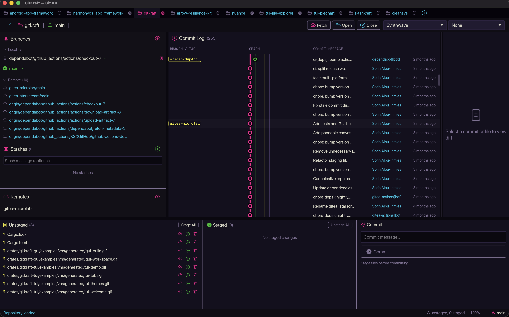
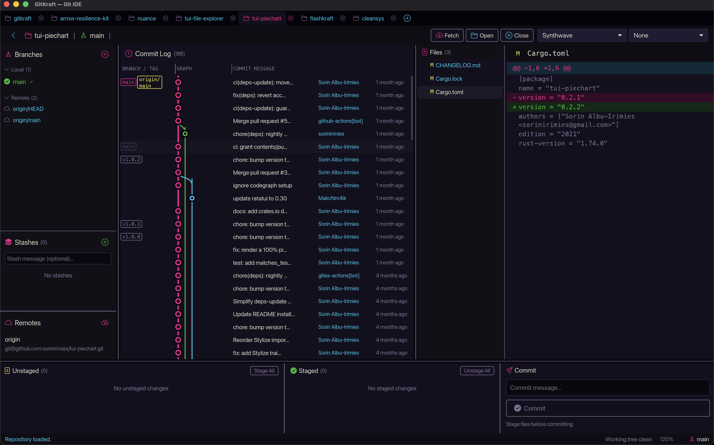
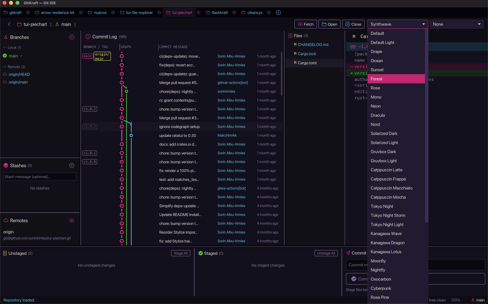

<div align="center">

# ⚡ GitKraft

**A Git IDE written entirely in Rust — desktop GUI & terminal UI**

[](https://crates.io/crates/gitkraft)
[](https://crates.io/crates/gitkraft)
[](https://crates.io/crates/gitkraft-tui)
[](https://docs.rs/gitkraft-core)
[](LICENSE)
[](https://github.com/sorinirimies/gitkraft/actions/workflows/security.yml)
[](https://github.com/sorinirimies/gitkraft/actions/workflows/fuzz.yml)

</div>

---

GitKraft ships two front-ends from a single Rust workspace:

| Binary | Use case |
|--------|----------|
| `gitkraft` | Desktop GUI — mouse, drag-to-resize panes, commit graph |
| `gitkraft-tui` | Terminal UI — keyboard-driven, great for SSH & headless machines |


## Preview

### Desktop GUI






### Terminal UI


## The hub: no more forge dashboards

Press `H` in the TUI (or the **Hub** button in the GUI) for pull requests, issues, CI and
notifications of **GitHub, GitLab, Gitea / Forgejo and Codeberg** in one place. `gitkraft-web`
serves the same on localhost.

| | |
|---|---|
| Dashboard | sections are saved queries (`dashboard.toml`): "Review requested", "My PRs", issues, CI of a repo, the inbox |
| Pull requests | description (Markdown), reviews, checks, diff, comments; approve, request changes, comment, merge, close |
| Issues | list, comment, close / reopen |
| CI | runs, jobs, steps, timeline, live log with errors extracted; re-run failed / all, cancel (GitHub / Gitea Actions, GitLab CI) |
| Pulse | contribution calendar over all accounts, PRs / issues / CI per period, activity per day |
| Notifications | per-project settings, desktop notifications, a bell with its state on every project |
| Mouse | click, wheel, drag a section tab to reorder, drag the divider to resize (TUI and GUI) |
| Images | PR and issue pictures in the TUI (Kitty, iTerm2, Sixel or half blocks) |

**Accounts.** Tokens are read, never stored: `GITKRAFT_TOKEN_<HOST>`, `GITHUB_TOKEN`, `GITLAB_TOKEN`,
`CODEBERG_TOKEN` / `GITEA_TOKEN`, or `gh auth login`. Self-hosted instances go in
`~/.config/gitkraft/accounts.toml`:

```toml
[[account]]
kind = "gitlab"      # github | gitlab | gitea (also forgejo, codeberg)
host = "git.example.com"

[[account]]
kind = "gitea"
host = "codeberg.org"
woodpecker = "https://ci.codeberg.org"   # CI runs, steps, logs, restart, cancel come from Woodpecker
```

A Woodpecker token (from the server's user page) is read from `GITKRAFT_WOODPECKER_TOKEN_<HOST>` or
`GITKRAFT_WOODPECKER_TOKEN`; Woodpecker restarts whole pipelines only and has no artifacts.

**Sign in once.** `gitkraft-tui login github.com` runs the OAuth device flow (GitHub, GitLab; needs an OAuth
application's client id: `--client-id`, `GITKRAFT_OAUTH_CLIENT_ID` or `oauth_client_id` in `accounts.toml`);
`login HOST --token` takes a pasted token and works everywhere. The token is checked, then stored in the
system keyring (macOS `security`, Linux `secret-tool`); `logout HOST` removes it. Lookup order: environment,
keyring, `gh` / `glab`, git's credential helper.

**Merging.** Besides review (approve, request changes, inline comments) and `m`/`M` merge or squash, a PR can
be updated, auto-merged, queued or force-merged from the TUI, the GUI and the web page:

| TUI | What | GitHub | GitLab | Gitea / Codeberg |
|---|---|---|---|---|
| `u` | update branch | `update-branch` (merge) | `rebase` | `update?style=merge\|rebase` |
| `W` | merge when checks pass | GraphQL auto-merge | `merge_when_pipeline_succeeds` | `merge_when_checks_succeed` |
| `Q` | add to merge queue | GraphQL `enqueuePullRequest` | merge train (same call as `W`) | same as `W` (no queue) |
| `!` | force merge (capital `Y` to confirm; GUI and web ask twice) | admin bypass if the branch rule allows it; with `Q` it jumps the queue | not available | `force_merge` |
| `Z` | cancel auto-merge / leave queue | disable auto-merge, else dequeue | cancel merge-when-pipeline-succeeds | delete scheduled merge |
| `S` | cycle the method used by `W`, `Q`, `!` | | | |

GitLab cannot merge by rebase through the merge call or force past its checks, and GitHub can only update a
branch by merging; those combinations say so instead of guessing.

**Labels.** `L` in the TUI (or the GUI's Labels button, text from the note box) edits labels of a PR or issue:
`+bug -wontfix \"good first issue\"`; GitHub, Gitea / Codeberg and GitLab.

**Clone.** `gitkraft-tui clone owner/name` (or `host/owner/name`, or a URL) clones with your system `git`, over
`--ssh` / `--https`, else the account's `clone_via` in `accounts.toml`, else https.

**Git over SSH.** fetch, pull and push use your system `git` and `ssh` (agent, `~/.ssh/config`, keychain), and
a failure says what to do. `gitkraft-tui ssh …` gets a key in place:

```sh
gitkraft-tui ssh setup github.com      # create ~/.ssh/gitkraft_github.com (or --key PATH), register it, configure, load, test
gitkraft-tui ssh list github.com       # keys on the account; ● = held by this machine
gitkraft-tui ssh revoke github.com ID  # remove one
gitkraft-tui ssh status                # key, config block, agent, connection per host
gitkraft-tui ssh switch ssh            # rewrite origin from https to ssh (or back)
```

Setup is idempotent, edits only a marked block of `~/.ssh/config` (and saves a backup first), and never sees a
passphrase (`--passphrase` lets `ssh-keygen` ask). The Hub's **SSH keys** view (`K`) does the same from the UI.
`clone_via = "ssh" | "https"` per `[[account]]` records which transport you prefer.

**Workflow inputs.** `D` (and the GUI's Dispatch) reads `workflow_dispatch.inputs` from the workflow file: defaults
fill what you leave out, `choice`/`boolean`/`number` values are checked, and a missing required input is named.
**Inline comments** work on removed lines too (old side), and in the GUI by clicking a diff line.

**Palette and more.** In the TUI `:` or Ctrl+P, in the GUI Ctrl/Cmd+P or the **Commands** button, opens a fuzzy
command palette with every action that applies to the selection. The GUI has a **Check out** button for pull
requests (the project must be open in a tab). `w` checks the selected pull request out into a worktree next to your checkout; `D` starts a workflow
by hand (`ci.yml main level=debug`); `A` downloads a run's artifacts. On a pull request's **Diff** tab (focus the
detail pane), `j`/`k` move a line cursor and `c` posts an inline review comment on that added or unchanged line.

**Dashboard** (`~/.config/gitkraft/dashboard.toml`; drag the tabs and it is rewritten):

```toml
[[section]]
name = "Review requested"
kind = "prs"                      # prs | issues | ci | inbox
involvement = "review_requested"  # authored | assigned | review_requested

[[section]]
name = "gitkraft CI"
kind = "ci"
repos = ["github.com/sorinirimies/gitkraft"]
branch = "master"
```

**Notifications** (`~/.config/gitkraft/notifications.toml`, per project; a repo may also carry
`.gitkraft/notifications.toml`). Later layers win: built-in, `[defaults]`, `[projects."host/owner/name"]`, the repo file.

```toml
[defaults]
enabled = true
poll_interval = "60s"
events = ["review_requested", "mention", "pr_opened", "issue_opened", "ci_failed"]
quiet_hours = "22:00-08:00"

[projects."github.com/sorinirimies/gitkraft"]
poll_interval = "30s"
branches = ["master", "release/*"]          # CI events only on these
labels = { exclude = ["wip"] }
authors = { exclude = ["dependabot[bot]"] }

[projects."github.com/org/noisy"]
enabled = false
```

`n` toggles the current project in the TUI (`N` everything, `z` snoozes one hour); the bell shows
`[*]` on, `[ ]` off, `[z]` snoozed, `[!]` error, `[?]` on but no poller running. While the TUI or GUI
hub is open it polls itself; run it headless with

```sh
gitkraft-tui notify --daemon       # or --once for cron
gitkraft-tui notify status | on | off | mute 2h | unmute | test | install
```

**Web:** `gitkraft-web` (needs Rust 1.98, so the MSRV job skips it) serves `http://127.0.0.1:3333`.
There is no login: do not bind it beyond localhost. Every action carries a per-run token the pages embed, so
another website cannot make the server act. The **SSH keys** page lists, sets up, tests and removes keys.

### MCP server: your forges for an AI assistant

`gitkraft-mcp` speaks the [Model Context Protocol](https://modelcontextprotocol.io) on stdio and gives an
assistant the same accounts and platforms the TUI, GUI and web use (GitHub, GitLab, Gitea, Codeberg, Woodpecker).
Tokens come from the same places as everywhere else (env, `gitkraft-tui login`, `gh`, `glab`, git credentials);
the checkout it starts in is the default repository, so `repo` can be left out.

```json
{ "mcpServers": { "gitkraft": { "command": "gitkraft-mcp" } } }
```

**Read-only by default.** Without `--write` the server has no tool that changes anything, on any platform.

| Read (always) | |
|---|---|
| `accounts` | hosts, your login, what each platform supports, whether writes are on |
| `my_pull_requests`, `my_issues`, `inbox` | what is yours, assigned to you, waiting for your review, in your notifications |
| `list_pull_requests`, `get_pull_request` | lists without descriptions; one PR with reviews, comments, checks and (on request, cut to a size) its diff |
| `list_issues`, `get_issue`, `list_labels` | |
| `ci_runs`, `ci_run`, `ci_job_log`, `list_workflows` | runs, jobs, and a job's log without colour codes: the tail, or only lines matching `grep` |
| `pulse` | PRs, issues, green and red CI over the last days |

| Write (`--write`) | |
|---|---|
| `comment`, `review`, `set_open`, `edit_labels` | |
| `merge_pull_request` | now, `when_green` or `queue`; merge, squash or rebase. `force` also needs `--allow-force` |
| `update_branch`, `cancel_auto_merge` | |
| `ci_rerun`, `ci_cancel`, `dispatch_workflow` | inputs are checked against the workflow file |

Tools carry the MCP `readOnlyHint` / `destructiveHint` annotations, so a client can ask before a merge.
Options: `--write`, `--allow-force`, `--repo host/owner/name` (env `GITKRAFT_MCP_WRITE`, `GITKRAFT_MCP_FORCE`,
`GITKRAFT_MCP_REPO`). Add `--write` to the client entry only for sessions where it should be able to act.

## Features

- **Branch management** — create, checkout, delete, rename, merge, rebase (local & remote)
- **Commit log with graph** — canvas DAG in GUI, box-drawing in TUI
- **Commit actions** — cherry-pick, revert, reset (soft/mixed/hard), create branch/tag at commit, copy SHA
- **Commit search** — incremental search across the commit log
- **Diff viewer** — working-dir, staged, and per-commit diffs with coloured hunks
- **File history & blame** — per-file commit history and line-by-line blame
- **Staging area** — stage/unstage files or all at once, discard or delete files
- **Stash management** — save, apply, pop, drop with optional messages
- **Multi-tab** — open multiple repos in tabs (GUI & TUI), sessions persisted
- **Remote operations** — fetch, push, force-push (`--force-with-lease`), pull (rebase), remote branch checkout/delete
- **Context menus (GUI)** — right-click branches, commits, stashes, and files for the full action set
- **Editor integration** — open files, blame, or `settings.json` in your configured editor
- **UI zoom (GUI)** — Ctrl/Cmd +/− to scale, persisted across launches
- **Directory browser (TUI)** — press `o` to browse and open repos
- **43 colour themes** — Dracula, Nord, Catppuccin, Tokyo Night, Kanagawa, Rose Pine, Cyberpunk, Synthwave, and more
- **Virtual scrolling** — smooth performance with large histories and long diffs
- **Two-phase diff loading** — file list appears instantly, diffs load per-file
- **Draggable pane dividers (GUI)** — layout saved automatically
- **Persisted settings** — theme, layout, recent repos, open tabs (`~/.config/gitkraft` style JSON, no external DB)

## Installation

```sh
# Desktop GUI
cargo install gitkraft

# Terminal UI
cargo install gitkraft-tui
```

Or download pre-built binaries from the [Releases page](https://github.com/sorinirimies/gitkraft/releases).

## Keyboard Shortcuts

### TUI — global (any pane)

| Key | Action |
|-----|--------|
| **←/→** or **Tab / Shift+Tab** | Switch panes |
| **/** | Search commits |
| **,** | Open `settings.json` in editor |
| **o** | Browse & open repo |
| **N / W** | New tab / close tab |
| **] / [** | Next / previous tab |
| **p / P** | Pull (rebase) / push |
| **r / f** | Refresh / fetch |
| **t** | Cycle theme |
| **T / O / E** | Theme panel / options panel / editor panel |
| **q** or **Ctrl+C** | Quit |

### TUI — Branches pane

| Key | Action |
|-----|--------|
| **j/k**, **Enter** | Navigate, checkout selected branch |
| **b** | Create new branch |
| **D** | Delete selected (local) branch |
| **X** | Delete selected remote branch |
| **m** | Merge selected branch into HEAD |
| **R** | Rebase HEAD onto selected branch |
| **e** | Rename selected branch |

### TUI — Commit Log pane

| Key | Action |
|-----|--------|
| **j/k**, **g/G** | Navigate, jump to first/last |
| **J/K**, **Space** | Range-select / toggle multi-select |
| **Enter** | Load diff for selected commit |
| **C** | Cherry-pick commit(s) |
| **e** | Revert commit(s) |
| **n / x / X** | Reset to commit — mixed / soft / hard |
| **F** | Force push (`--force-with-lease`) |
| **y** | Copy commit SHA to clipboard |
| **a** | Open commit action popup (branch/tag here, etc.) |

### TUI — Diff View pane

| Key | Action |
|-----|--------|
| **j/k**, **l/Enter**, **h** | Navigate files, open, back to file list |
| **J/K** | Range-select files |
| **g/G**, **d/u** | Scroll to top/bottom, page down/up (in content) |
| **H** | File history |
| **B** | Blame |
| **e** | Open in editor |
| **o** | Restore file from commit to working directory |

### TUI — Staging pane

| Key | Action |
|-----|--------|
| **j/k**, **Space** | Navigate, toggle selection |
| **Tab** | Switch focus: unstaged ↔ staged |
| **s/u** | Stage / unstage (selected files, or current) |
| **S/U** | Stage / unstage all |
| **d** | Discard changes (press twice to confirm) |
| **D** | Delete file (press twice to confirm) |
| **c** | Commit |
| **z/Z** | Stash save / pop |
| **H/B** | File history / blame |
| **e** | Open in editor |

### TUI — Stash pane

| Key | Action |
|-----|--------|
| **j/k** | Navigate |
| **Enter / p** | Pop selected stash |
| **a** | Apply selected stash (keep in list) |
| **d** | Drop selected stash |

### GUI

| Key | Action |
|-----|--------|
| **Ctrl/Cmd + +/−/0** | Zoom in / out / reset |
| **Ctrl/Cmd + F** | Toggle search |
| **Ctrl/Cmd + T** or **N** | New tab |
| **Ctrl/Cmd + W** | Close current tab |
| **Ctrl/Cmd + R** or **F5** | Refresh |
| **Ctrl/Cmd + ,** | Open `settings.json` in editor |
| **Shift + ↑/↓** | Extend range selection |
| **Esc** | Close overlay / context menu |

Right-click branches, commits, stashes, or files for the full context menu.

## Building from Source

```sh
git clone https://github.com/sorinirimies/gitkraft.git
cd gitkraft
cargo build --release

# Run
cargo run --release -p gitkraft       # GUI
cargo run --release -p gitkraft-tui   # TUI
cargo run --release -p gitkraft-tui -- /path/to/repo
```

**Prerequisites:** a recent stable Rust toolchain (2021 edition).

On Linux, the GUI also needs windowing/graphics dev libraries (X11 + Wayland):

```sh
sudo apt-get install -y pkg-config libxkbcommon-dev libx11-dev libxrandr-dev \
  libxinerama-dev libxcursor-dev libxi-dev libwayland-dev libgl1-mesa-dev \
  libfontconfig1-dev libssl-dev
```

## Themes

43 built-in themes, persisted per-user and shared between GUI and TUI:

> Default · Default Light · Grape · Ocean · Sunset · Forest · Rose · Mono · Neon · Dracula · Nord · Solarized Dark/Light · Gruvbox Dark/Light · Catppuccin Latte/Frappé/Macchiato/Mocha · Tokyo Night/Storm/Light · Kanagawa Wave/Dragon/Lotus · Moonfly · Nightfly · Oxocarbon · Cyberpunk · Rose Pine/Moon/Dawn · Ayu Mirage · Everforest Dark · Atom One Dark/Light · Night Owl · Poimandres · Flexoki Dark/Light · Carbonfox · Andromeda · Synthwave

## Development

```sh
just build            # build workspace
just run              # run GUI
just run-tui          # run TUI
just test             # run all tests
just check-all        # fmt + clippy + test + nu tests
just release 0.6.0    # bump, tag, push (runs all checks)
just push-all         # push to GitHub + Gitea
just install-tools    # install git-cliff + nushell
```

CI runs on both **GitHub Actions** and **Gitea Actions** with automated nightly dependency updates.

## Architecture

```
gitkraft-gui ──┐
               ├──▶ gitkraft-core ──▶ git2, serde/serde_json, chrono
gitkraft-tui ──┘
```

`gitkraft-core` owns all Git logic and shared types (branches, commits, diff, log, remotes,
staging, stash, persistence, themes) — no UI code. Both front-ends are thin wrappers around
it and follow **The Elm Architecture** (State → View → Message → Update). Settings, recent
repos, and layout are persisted as plain JSON on disk — no embedded database.

## Contributing

1. Fork → branch → make changes → ensure `just check-all` passes → PR

## License

[MIT](LICENSE)

---

<div align="center">

Made with 🦀 by [Sorin Irimies](https://github.com/sorinirimies)

</div>
